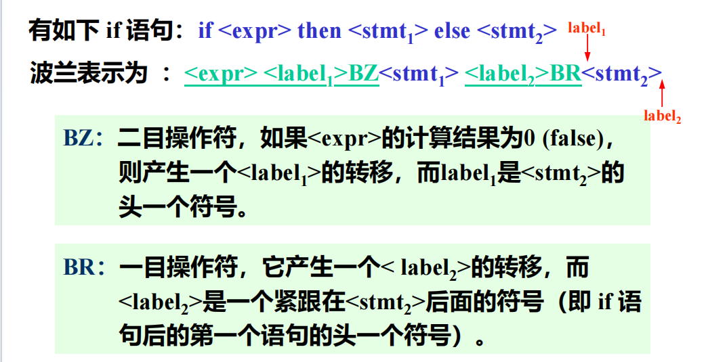

# 一、波兰表示

​	一般编译程序都生成中间代码，然后再生成目标代码，主要优点是可移植，且易于目标代码优化

​	当读到操作数时，就立即输出该操作数；当遇到操作符时，则要与栈顶操作符比较优先级，若栈顶操作符优先级高于栈外，则输出该栈顶操作符；反之，则栈外操作符入栈

波兰表示法的优点：

1. 在不使用括号的情况下可以无二义地说明算数表达式
2. 波兰表示法更容易转换成机器的汇编语言或机器语言
3. 波兰表示不仅能用来作为算数表达式的中间代码形式，而且也能作为其他语言结构的中间代码形式

## if语句的波兰表示

# 二、N-元表示

​	在该表示中，每条指令由n个域所组成，通常第一个域表示操作符，其余为操作数

​	常见的n元表示是：三元式 四元式

| 操作符 | 左操作数 | 右操作数 |
| ------ | -------- | -------- |

