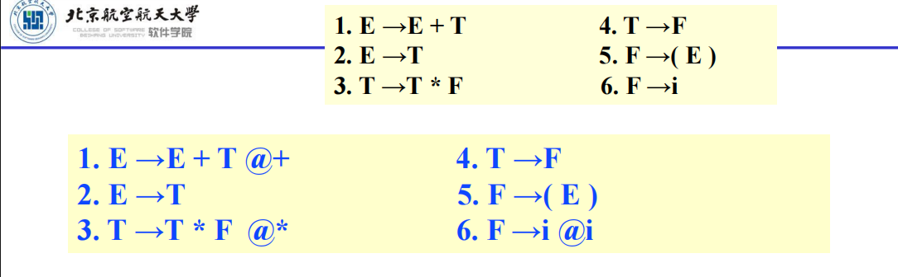
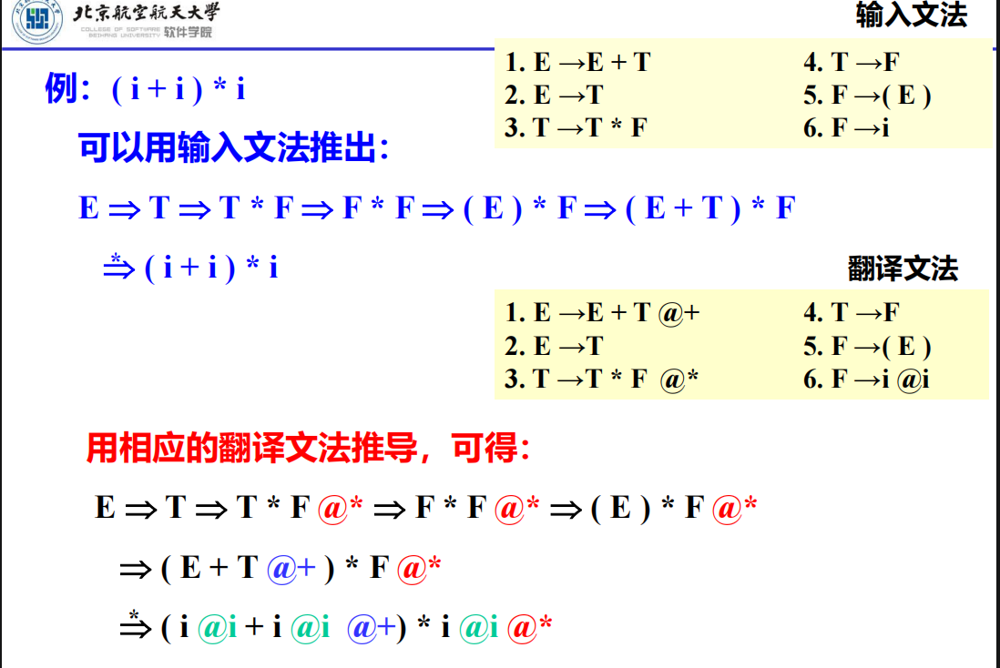
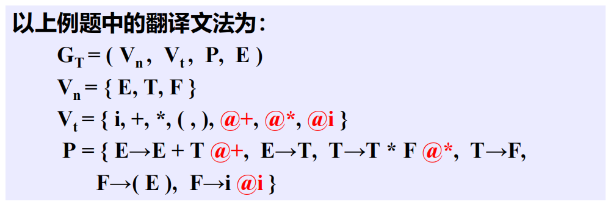
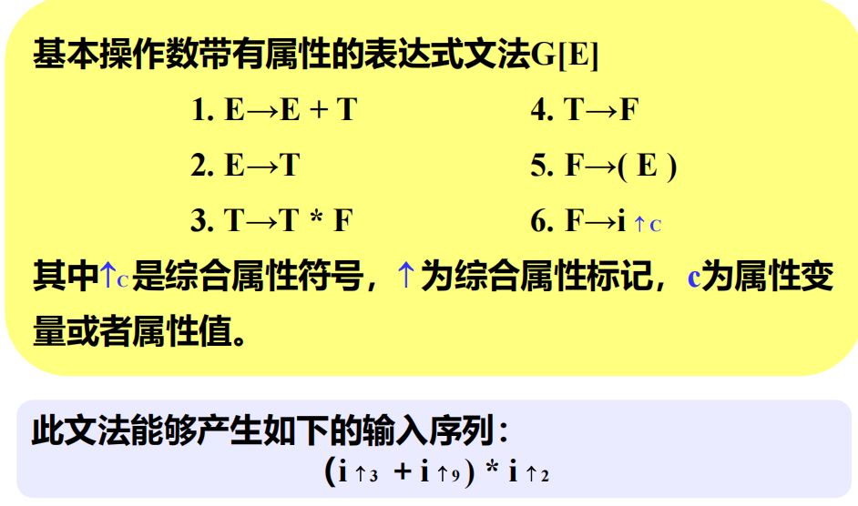
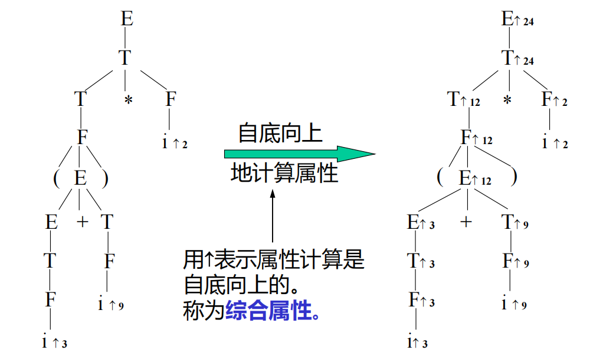
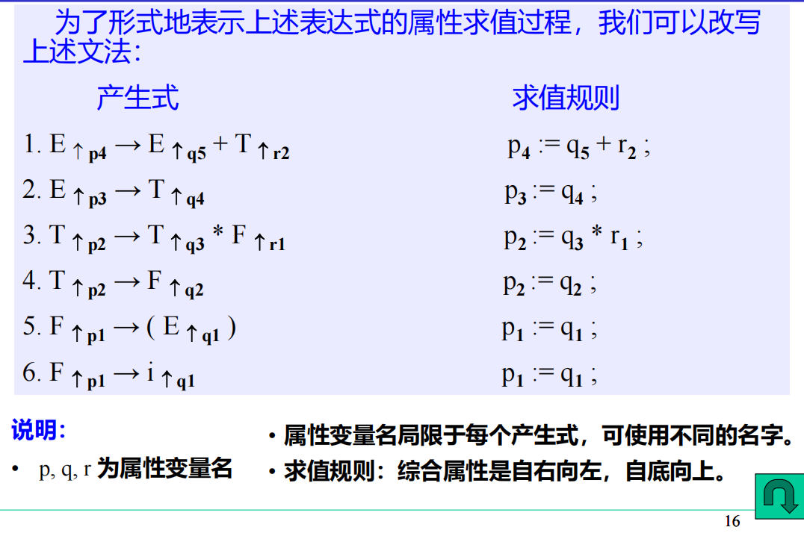
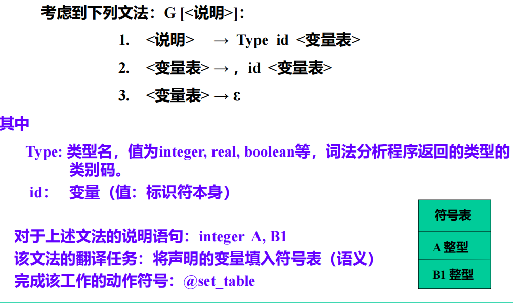
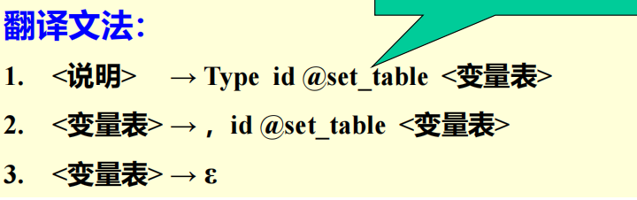
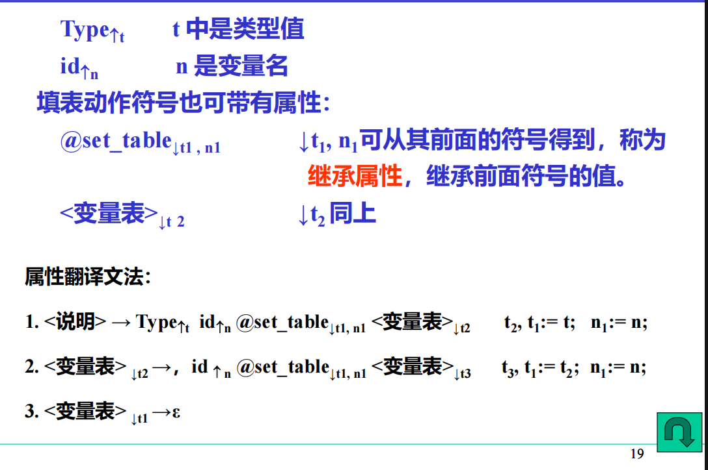

# 一、翻译文法和语法制导翻译

> 翻译的任务是：中缀表达式->逆波兰表示
>
> 若翻译任务是要将中缀表达式简单变换为波兰后缀表示，只需在上述文法中插入相应的动作符号

其中：

​	@+，@*，@i为动作符号

​	在该具体示例中，其对应语义子程序的功能是要输出打印动作符号标记后面的字符串

## 1.1 输入文法和翻译文法的概念

- 输入文法：未插入动作符号时的文法。

​		  由输入文法可以通过推导产生输入序列

- 翻译文法：插入动作符号的文法

       	   由翻译文法可以通过推导产生活动序列

活动序列：由翻译文法推导出的符号串，由终结符和动作符号组成

- 从活动序列中，抽去动作符号则得输入序列(i+i)*i
- 从活动序列中，抽去输入序列，则得到动作序列，执行动作序列，则完成翻译任务

> 翻译文法是上下文无关文法，终结符号集由输入符号和动作符号组成
>
> 由翻译文法所产生的终结符号串称为活动序列

- 符号串翻译文法：输入文法中的动作符号对应的语义子程序是输出动作符号标记@后的字符串的文法
- 语法制导翻译：按翻译文法进行的翻译

# 二、属性翻译文法

> 在翻译文法的基础上，可以进一步定义属性文法
>
> 翻译文法中的符号，包括终结符、非终结符和动作符号均可带有属性，这样能更好地描述和实现编译过程

属性可以分为两种：

- 综合属性：语义函数的返回值
- 继承属性：语义函数的参数

## 2.1 综合属性

根据给定的文法，可写出该输入序列的语法树

## 2.2 继承属性

`@set_table`的插入位置表示填表动作的时机

## 2.3 属性翻译文法的自顶向下翻译

### 1. L-属性翻译文法(L-ATG)

​	这是属性翻译文法中的一种。其输入文法要求是LL(1)文法，可用自顶向下分析方法构造分析器，在分析过程中可进行属性求值

特点：某个符号的继承属性只依赖于该符号左边的信息

> 定义：L-属性翻译文法是带有下列说明的翻译文法：
>
> 1. 文法中的终结符，非终结符及动作符号都带有属性，且每个属性都有一个值域
>
> 2. 非终结符及动作符号的属性可分为继承属性和综合属性
>
> 3. 开始符号的继承属性具有指定的初始值
>
> 4. 输入符号(终结符号)的每个综合属性具有指定的初始值
>
> 5. 属性值的求值规则如下：
>
>     继承属性——体现自顶向下，自左向右的求值特性
>
>     1. 产生式左部非终结符号的继承属性值，取前面产生式右部该符号已有的继承属性值
>     2. 产生式右部符号的继承属性值，用该产生式左部符号的继承属性或出现在该符号左部的符号的属性值进行计算
>
>     综合属性——体现自底向上，自右向左的求值特性
>
>     1. 产生式右部非终结符号的综合属性值，取其下部产生式左部同名非终结符号的综合属性值
>     2. 产生式左部非终结符号的综合属性值，用该产生式左部符号的继承属性或某些右部符号的任意属性进行计算
>     3. 动作符号的综合属性用该符号的继承属性或某些右部符号的任意属性进行计算

注意：

1. 终结符只有综合属性(它们由词法分析器提供)
2. 非终结符和动作符号既可以有综合属性也可有继承属性
3. 文法开始符号的所有继承属性作为属性计算前的初始值

### 2. 简单赋值形式的L-属性翻译文法(SL-ATG)

> 定义 一个L-ATG被定义为简单赋值形式的，当且仅当满足如下条件：
>
> 1. 产生式右部符号的继承属性是一个常量，它等于左部符号的继承属性值，或等于出现在所给符号左部某个符号的综合属性值
> 2. 产生式左部非终结符号的综合属性是一个常量，它等于其自身的继承属性值或等于右部某个符号的综合属性值

# 三、自顶向下语法制导翻译

